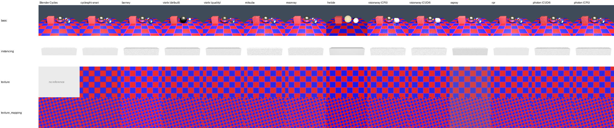
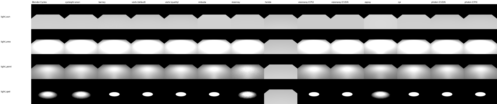
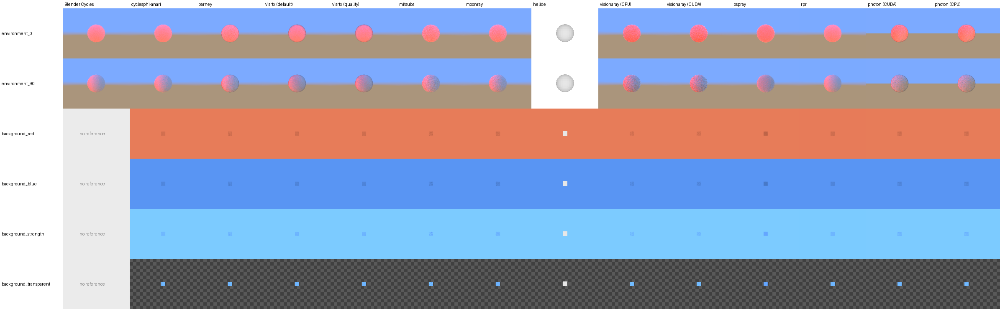
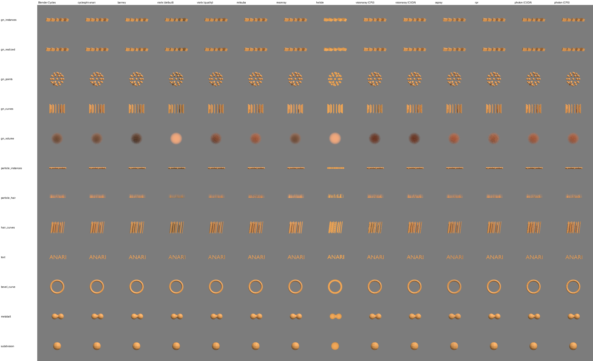

# ANARI rendering in Blender on Windows

The [README](README.md) describes what the ANARI device of Blender is, how it is used and
what its limits are. This document covers the stack on Windows, the platform it is developed
on: where the sources are, how each component is built, how the tests are run and what they
give. [LINUX.md](LINUX.md) and [MACOS.md](MACOS.md) describe the other two platforms as
differences from this one.

Everything here was done on one machine: Windows 11 with Visual Studio 2022, an NVIDIA
RTX 2080 Ti (11 GB) and a Xeon E5-2640 v3 with 32 threads, in one workspace directory
(`F:\work\anari`). Nothing is installed outside of it.

Contents:

1. [State](#1-state)
2. [Workspace and sources](#2-workspace-and-sources)
3. [Prerequisites](#3-prerequisites)
4. [Building](#4-building)
5. [Running the smoke tests](#5-running-the-smoke-tests)
6. [Smoke test results](#6-smoke-test-results)
7. [pynari](#7-pynari)

## 1. State

| ANARI library | Back end | Built into | Smoke tests |
|---|---|---|---|
| `cycles` | CPU, CUDA, OptiX | `install/bin` | pass |
| `barney` | OptiX | `install/bin` | pass |
| `visrtx` | OptiX (`default` and `quality` renderer) | `install/bin`; with MDL and MaterialX in `install/visrtx-mdl/bin` | pass |
| `mitsuba` | `cuda_ad_rgb`, `llvm_ad_rgb`, `scalar_rgb` | `install/mitsuba/bin` | pass (`cuda_ad_rgb`) |
| `moonray` | CPU, XPU | `install/moonray` | pass |
| `helide` | CPU | `install/bin` | all but `test_environment_map`, `test_camera_clip` and `test_light_falloff` |
| `visionaray`, `visionaray_cuda` | CPU, CUDA | `install/bin` | pass |
| `ospray` | CPU | `install/ospray/bin` | pass |
| `rpr` | GPU (Northstar with CUDA) | `install/rpr/bin` | pass |
| `photon` | CUDA with OptiX, CPU with Embree | `install/photon/bin`, `install/photon_cpu/bin` | pass |

The suite and what it checks are described in the [README](README.md#4-smoke-tests), the
numbers in [section 6](#6-smoke-test-results). How the devices compare with Cycles on whole
scenes (the Cycles demo files) is in
[MATERIALS.md](MATERIALS.md#56-what-the-smoke-test-shows).

## 2. Workspace and sources

All repositories are cloned side by side in `F:\work\anari`. Builds go to
`F:\work\anari\build\<name>` and installs to `F:\work\anari\install`.

| Directory | Repository | Branch |
|---|---|---|
| `ANARI-SDK` | https://github.com/jar091/ANARI-SDK | `mjar/devel`, based on `next_release` (ANARI 0.17) |
| `barney` | https://github.com/jar091/barney | `mjar/devel`, based on `main` (with submodules) |
| `VisRTX` | https://github.com/jar091/VisRTX | `mjar/devel`, based on `next_release` |
| `cyclesphi-anari` | https://github.com/It4innovations/cyclesphi-anari | `cyclesphi_dev`, merged with jeffamstutz/anari-cycles |
| `mitsuba-anari` | https://github.com/jar091/mitsuba3-anari | `main` (with submodules: Mitsuba 3 in `ext/mitsuba3`) |
| `openmoonray-anari` | https://github.com/jar091/openmoonray-anari | `main` (with submodules: the MoonRay forks under `external/openmoonray`) |
| `visionaray` | https://github.com/jar091/visionaray | `mjar/devel`, based on `master` (header-only ray tracing library) |
| `anari-visionaray` | https://github.com/jar091/anari-visionaray | `mjar/devel`, based on `main` |
| `anari-ospray` | https://github.com/jar091/anari-ospray | `mjar/devel`, based on `main` |
| `RadeonProRenderANARI` | https://github.com/jar091/RadeonProRenderANARI | `mjar/devel`, based on `main`: ported to ANARI 0.17 and RadeonProRender SDK 3.1.7.1 |
| `photon` | https://github.com/jar091/photon | `mjar/devel`, based on `main`: with a new ANARI device |
| `blenderphi` | https://github.com/It4innovations/blenderphi | `main-anari` |
| `pynari` | https://github.com/jar091/pynari | `mjar/devel` (`jar091/devel` merged with the upstream `master`), see [`pynari/doc/windows/README.md`](../../../pynari/doc/windows/README.md) |

Install layout:

```
install/
  bin/              ANARI SDK, helide, barney, VisRTX, anari-visionaray (CPU and CUDA),
                    cyclesphi-anari (+ bin/cycles/lib kernels)
  include/visionaray, lib/cmake/visionaray
  lib/cmake/anari-0.17.0
  mitsuba/bin/      mitsuba-anari and Mitsuba / Dr.Jit DLLs
  moonray/          MoonRay runtime: bin/, rdl2dso/, coredata/, shaders/
  ospray/bin/       anari-ospray and the OSPRay runtime (Embree, Open VKL, OIDN, TBB)
  rpr/bin/          RadeonProRenderANARI, RadeonProRender64.dll, Northstar64.dll,
                    cudart64_13.dll, hipbin/ (GPU kernels), cache/ (written at runtime)
  photon/bin/       Photon, GPU build (Kokkos Cuda, OptiX)
  photon_cpu/bin/   Photon, CPU build (Kokkos Threads, Embree) with Blender's Embree and TBB
  kokkos-cuda/, kokkos-host/   the two Kokkos installs
external/
  llvm/             LLVM release with LLVM-C.dll (Mitsuba llvm_ad_rgb)
  ospray/           OSPRay 3.2.0 binary release
  rpr/              RadeonProRender SDK 3.1.7.1 with the hipbin kernels
  cuda13/           CUDA 13 runtime (cudart64_13.dll) for Northstar
  kokkos/           Kokkos 5.2.2 sources
build/
  blender/bin/Release/blender.exe
  logs/             build and test logs
  test_out/<library>/   images written by the smoke tests
```

## 3. Prerequisites

| Tool | Version used |
|---|---|
| Visual Studio 2022 (C++ workload) | 17.14 |
| CMake | 4.2.1 (barney needs `-DCMAKE_POLICY_VERSION_MINIMUM=3.5`) |
| CUDA Toolkit | 12.8 |
| OptiX headers | 9.0, from `barney/submodules/optix` (used by barney, VisRTX and cyclesphi-anari) |
| OptiX SDK | 8.1 (MoonRay XPU only) |
| Python | 3.13 (for build scripts and pynari) |
| Ninja | 1.12, the one of Visual Studio (Kokkos and Photon) |
| Git with Git LFS | 2.52 / 3.7 |
| GPU | NVIDIA RTX 2080 Ti (sm_75), driver 591.86 |

Blender's precompiled libraries (`blenderphi/lib/windows_x64`) are also used by
cyclesphi-anari and MoonRay, so that the DLLs loaded into the Blender process match
(OpenVDB, OpenImageIO, TBB, ...):

```bat
cd blenderphi
git submodule update --init --progress lib/windows_x64
git lfs pull
```

## 4. Building

The commands are run from `F:\work\anari`, using Git Bash or a Visual Studio developer
prompt. All builds are Release builds.

### 4.1 ANARI SDK (with helide)

```bat
cmake -S ANARI-SDK -B build/anari-sdk -G "Visual Studio 17 2022" -A x64 ^
  -DCMAKE_INSTALL_PREFIX=F:/work/anari/install -DBUILD_TESTING=OFF -DBUILD_EXAMPLES=ON ^
  -DBUILD_HELIDE_DEVICE=ON -DBUILD_HELIDE_GPU_DEVICE=OFF -DBUILD_VIEWER=OFF -DBUILD_CTS=OFF
cmake --build build/anari-sdk --config Release --parallel 16
cmake --install build/anari-sdk --config Release
```

All devices are built against this SDK:
`-Danari_DIR=F:/work/anari/install/lib/cmake/anari-0.17.0`.

### 4.2 barney

```bat
git -C barney submodule update --init --recursive
cmake -S barney -B build/barney -G "Visual Studio 17 2022" -A x64 ^
  -DCMAKE_INSTALL_PREFIX=F:/work/anari/install -DCMAKE_PREFIX_PATH=F:/work/anari/install ^
  -DCMAKE_CUDA_ARCHITECTURES=75 -DCMAKE_POLICY_VERSION_MINIMUM=3.5 ^
  -DPython3_EXECUTABLE=D:/apps/Python313/python.exe
cmake --build build/barney --config Release --parallel 16
cmake --install build/barney --config Release
```

### 4.3 VisRTX (RTX device only)

```bat
cmake -S VisRTX -B build/visrtx -G "Visual Studio 17 2022" -A x64 ^
  -DCMAKE_INSTALL_PREFIX=F:/work/anari/install ^
  -Danari_DIR=F:/work/anari/install/lib/cmake/anari-0.17.0 ^
  -DVISRTX_BUILD_GL_DEVICE=OFF -DOptiX_ROOT_DIR=F:/work/anari/barney/submodules/optix ^
  -DVISRTX_MIN_ARCH=75
cmake --build build/visrtx --config Release --parallel 16
cmake --install build/visrtx --config Release
```

### 4.4 cyclesphi-anari (Cycles as an ANARI device)

cyclesphi-anari builds its own Cycles (the cyclesphi fork in `cyclesphi-anari/cyclesphi`)
against Blender's precompiled libraries. It needs CUDA and OptiX for the GPU kernels, and
OpenImageDenoise.

```bat
git -C cyclesphi-anari submodule update --init --recursive
cmake -S cyclesphi-anari -B build/cyclesphi-anari -G "Visual Studio 17 2022" -A x64 ^
  -DCMAKE_INSTALL_PREFIX=F:/work/anari/install ^
  -Danari_DIR=F:/work/anari/install/lib/cmake/anari-0.17.0 ^
  -DCYCLES_LIB_DIR=F:/work/anari/blenderphi/lib/windows_x64 ^
  -DWITH_CYCLESPHI=OFF ^
  -DANARI_CYCLES_USE_OPTIX=ON -DANARI_CYCLES_USE_OIDN=ON ^
  -DOPTIX_ROOT_DIR=F:/work/anari/barney/submodules/optix ^
  "-DANARI_CYCLES_CUDA_ARCHS=sm_75;compute_75"
cmake --build build/cyclesphi-anari --config Release --parallel 16
cmake --install build/cyclesphi-anari --config Release
```

The precompiled kernels are installed to `install/bin/cycles/lib` next to
`anari_library_cycles.dll`. The device finds them there without a CUDA or OptiX SDK at
runtime. Changes to `cyclesphi/src/kernel` recompile the GPU kernels, which takes about
20 minutes.

### 4.5 mitsuba-anari

mitsuba-anari builds Mitsuba 3 and Dr.Jit as dependencies. Mitsuba is a git submodule
(`ext/mitsuba3`), which has to be checked out with its own submodules first.

```bat
git -C mitsuba-anari submodule update --init --recursive
cmake -S mitsuba-anari -B build/mitsuba-anari -G "Visual Studio 17 2022" -A x64 ^
  -DCMAKE_INSTALL_PREFIX=F:/work/anari/install/mitsuba ^
  -DCMAKE_PREFIX_PATH=F:/work/anari/install -DMITSUBA_ANARI_USE_SYSTEM_ANARI_SDK=ON ^
  -DMITSUBA_ANARI_DEP_CONFIGS=Release -DPython3_EXECUTABLE=D:/apps/Python313/python.exe ^
  -DBUILD_TESTING=OFF
cmake --build build/mitsuba-anari --config Release --parallel 16
cmake --install build/mitsuba-anari --config Release
```

The CPU variant `llvm_ad_rgb` needs the LLVM C API (`LLVM-C.dll`), which is not part of
Windows or Visual Studio. Take it from the official LLVM release
(`clang+llvm-20.1.8-x86_64-pc-windows-msvc.tar.xz` from
https://github.com/llvm/llvm-project/releases), extract it to `external/llvm`, and install
it next to the device:

```bat
tar -xf clang+llvm-20.1.8-x86_64-pc-windows-msvc.tar.xz -C external/llvm
cmake build/mitsuba-anari ^
  -DMITSUBA_ANARI_LLVM_RUNTIME=F:/work/anari/external/llvm/clang+llvm-20.1.8-x86_64-pc-windows-msvc/bin/LLVM-C.dll
cmake --install build/mitsuba-anari --config Release
```

Without it, the device falls back to `scalar_rgb` and prints a warning.

### 4.6 openmoonray-anari (MoonRay)

The device repository carries its dependencies in `external/` (a vcpkg tree and prebuilt
installs). vcpkg's OpenVDB is replaced by Blender's OpenVDB 13. Only one OpenVDB can be
loaded into the Blender process, so MoonRay must use the same one.

1. **Build MoonRay core with XPU** (OptiX SDK 8.1), against Blender's OpenVDB, into
   `build/moonray-core`:

   ```powershell
   powershell -ExecutionPolicy Bypass -File openmoonray-anari\scripts\build-moonray-windows.ps1 `
     -Target moonray -Xpu `
     -OpenVdbRoot F:\work\anari\blenderphi\lib\windows_x64\openvdb `
     -BuildRoot F:\work\anari\build\moonray-core
   ```

2. **Build the ANARI device** with Ninja, inside the VS developer shell that the script
   enters:

   ```powershell
   $cmd = 'cmake -S . -B F:/work/anari/build/openmoonray-anari -G Ninja -DCMAKE_BUILD_TYPE=Release ' +
          '-Danari_DIR=F:/work/anari/install/lib/cmake/anari-0.17.0 ' +
          '-DCMAKE_INSTALL_PREFIX=F:/work/anari/install/moonray ' +
          '-DOPENMOONRAY_ANARI_BUILD_TESTS=OFF -DOPENMOONRAY_ANARI_BUILD_EXAMPLES=OFF; ' +
          'cmake --build F:/work/anari/build/openmoonray-anari -j 8'
   cd openmoonray-anari
   & .\scripts\dev-shell-build.ps1 -Command $cmd
   ```

   The DWA materials and the pattern maps are in moonshine, which is built on top of the
   MoonRay core (about 35 minutes). The shader graph export needs them:

   ```powershell
   powershell -ExecutionPolicy Bypass -File openmoonray-anari\scripts\build-moonray-windows.ps1 `
     -Target moonshine -Xpu `
     -OpenVdbRoot F:\work\anari\blenderphi\lib\windows_x64\openvdb `
     -BuildRoot F:\work\anari\build\moonray-core
   ```

   The device repository has one shader of its own, `AnariBumpNormalMap` in `dso/` (a
   normal map from a height, for the Bump node and for displacement used as bump; moonshine
   has none). It is built after moonshine with the same script and the same arguments but
   `-Target anari_dso`, and lands in the same `rdl2dso` directory. Without it every material
   with a bump shows MoonRay's error material. The device itself needs nothing of Blender
   or Cycles to build.

3. **Stage the runtime** into `install/moonray`:

   ```powershell
   $stage = "F:\work\anari\install\moonray"; $src = "F:\work\anari\openmoonray-anari\external"
   New-Item -ItemType Directory -Force "$stage\bin" | Out-Null
   Copy-Item F:\work\anari\build\openmoonray-anari\src\anari_library_moonray\anari_library_moonray.dll "$stage\bin"
   Copy-Item "$src\installs\openmoonray\bin\*.dll" "$stage\bin"
   Copy-Item "$src\vcpkg-installed\x64-windows\bin\*.dll" "$stage\bin"
   foreach ($d in "rdl2dso","coredata","shaders") { Copy-Item "$src\installs\openmoonray\$d" $stage -Recurse -Force }
   ```

At runtime the device sets `RDL2_DSO_PATH` to `install/moonray/rdl2dso` and adds its own
directory to the DLL search path, so the MoonRay DSOs find their dependencies.

### 4.7 anari-visionaray (Visionaray)

Visionaray is a header-only library once its viewer, examples and `common` library are
switched off. It is installed first, with CUDA enabled so that its package exports the CUDA
runtime dependency:

```bat
cmake -S visionaray -B build/visionaray -G "Visual Studio 17 2022" -A x64 ^
  -DCMAKE_INSTALL_PREFIX=F:/work/anari/install ^
  -DVSNRAY_ENABLE_EXAMPLES=OFF -DVSNRAY_ENABLE_VIEWER=OFF -DVSNRAY_ENABLE_COMMON=OFF ^
  -DVSNRAY_ENABLE_CUDA=ON -DVSNRAY_ENABLE_TBB=OFF -DBUILD_TESTING=OFF
cmake --build build/visionaray --config Release --target install
```

The device builds one ANARI library per back-end: `anari_library_visionaray.dll` (CPU) and,
with `ANARI_VISIONARAY_ENABLE_CUDA`, `anari_library_visionaray_cuda.dll`:

```bat
cmake -S anari-visionaray -B build/anari-visionaray -G "Visual Studio 17 2022" -A x64 ^
  -DCMAKE_INSTALL_PREFIX=F:/work/anari/install -DCMAKE_PREFIX_PATH=F:/work/anari/install ^
  -Danari_DIR=F:/work/anari/install/lib/cmake/anari-0.17.0 ^
  -DBUILD_SHARED_LIBS=ON -DANARI_VISIONARAY_ENABLE_CUDA=ON -DANARI_VISIONARAY_ENABLE_NANOVDB=ON
cmake --build build/anari-visionaray --config Release --parallel 16
cmake --install build/anari-visionaray --config Release
```

The CPU library compiles in about a minute. The CUDA library takes about 10 minutes: its
`.cu` files are compiled one after the other, and every change to a header under `dco/` or
`renderer/` recompiles them.

### 4.8 anari-ospray (OSPRay)

anari-ospray needs OSPRay 3.2.0 or later. The binary release of OSPRay is used, which
brings Embree, Open VKL, Open Image Denoise and TBB with it:

```bat
mkdir external\ospray
curl -L -o external/ospray/ospray-3.2.0.x86_64.windows.zip ^
  https://github.com/RenderKit/ospray/releases/download/v3.2.0/ospray-3.2.0.x86_64.windows.zip
tar -xf external/ospray/ospray-3.2.0.x86_64.windows.zip -C external/ospray

set OSPRAY=F:/work/anari/external/ospray/ospray-3.2.0.x86_64.windows
cmake -S anari-ospray -B build/anari-ospray -G "Visual Studio 17 2022" -A x64 ^
  -DCMAKE_INSTALL_PREFIX=F:/work/anari/install/ospray ^
  -Danari_DIR=F:/work/anari/install/lib/cmake/anari-0.17.0 ^
  -Dospray_DIR=%OSPRAY%/lib/cmake/ospray-3.2.0 -DCMAKE_PREFIX_PATH=%OSPRAY% ^
  -DPython3_EXECUTABLE=D:/apps/Python313/python.exe
cmake --build build/anari-ospray --config Release --parallel 16
cmake --install build/anari-ospray --config Release
```

The OSPRay runtime is staged next to the device, into `install/ospray/bin`. The MPI modules,
the test library and the MSVC runtime of the release are not needed:

```powershell
Get-ChildItem F:\work\anari\external\ospray\ospray-3.2.0.x86_64.windows\bin -Filter *.dll |
  Where-Object { $_.Name -notmatch 'mpi|testing|vcruntime|msvcp|concrt' } |
  Copy-Item -Destination F:\work\anari\install\ospray\bin
```

The device and its runtime live in their own directory because Blender ships DLLs with the
same names (`embree4.dll`, `tbb12.dll`, `OpenImageDenoise.dll`). Inside Blender, the copies
Blender has already loaded are used; OSPRay 3.2.0 works with them. The device loads
`ospray_module_cpu.dll` from its own directory, so that Open VKL and the other
dependencies are found without `PATH`.

### 4.9 RadeonProRenderANARI (Radeon ProRender)

The device uses the binaries of the RadeonProRender SDK (`RadeonProRender64.dll` and the
Northstar plugin), which live in the SDK repository itself. The precompiled GPU kernels are
in its `hipbin` submodule (`*.hipbin` for AMD, `*.cudabin` for NVIDIA GPUs):

```bat
git clone --depth 1 --branch v3.1.7.1 ^
  https://github.com/GPUOpen-LibrariesAndSDKs/RadeonProRenderSDK.git external/rpr
git -C external/rpr submodule update --init --depth 1 hipbin
```

On NVIDIA GPUs, Northstar 3.1.7 loads the CUDA 13 runtime (`cudart64_13.dll`). It is not
part of the SDK or of CUDA 12.8; it is taken from NVIDIA's Python wheel:

```bat
mkdir external\cuda13
D:\apps\Python313\python.exe -m pip download "nvidia-cuda-runtime>=13,<14" --no-deps ^
  --only-binary=:all: --platform win_amd64 -d external/cuda13
D:\apps\Python313\python.exe -m zipfile -e ^
  external/cuda13/nvidia_cuda_runtime-13.4.92-py3-none-win_amd64.whl external/cuda13/wheel
```

```bat
cmake -S RadeonProRenderANARI -B build/rpr-anari -G "Visual Studio 17 2022" -A x64 ^
  -Danari_DIR=F:/work/anari/install/lib/cmake/anari-0.17.0 ^
  -DRPR_SDK_ROOT=F:/work/anari/external/rpr ^
  -DRPR_CUDA_RUNTIME_LIBRARY=F:/work/anari/external/cuda13/wheel/nvidia/cu13/bin/x86_64/cudart64_13.dll ^
  -DCMAKE_INSTALL_PREFIX=F:/work/anari/install/rpr
cmake --build build/rpr-anari --config Release --parallel 16
cmake --install build/rpr-anari --config Release
```

The install step puts everything the device needs into `install/rpr/bin`:
`anari_library_rpr.dll`, `RadeonProRender64.dll`, `Northstar64.dll`, `cudart64_13.dll` and
the kernel directory `hipbin` (548 MB; `-DRPR_ANARI_INSTALL_KERNELS=OFF` leaves it out). At
runtime the device loads these from its own directory and writes RPR's kernel cache to
`install/rpr/bin/cache`. Without the CUDA 13 runtime it warns and renders on the CPU.

### 4.10 Photon (Kokkos)

Photon is a wavefront path tracer written with [Kokkos](https://github.com/kokkos/kokkos).
Two builds of its ANARI device are made, both with the library name `photon`:

| Build | Kokkos back-end | Ray tracing back-end | Installed to |
|---|---|---|---|
| GPU | Cuda | OptiX (the 9.0 headers of barney) | `install/photon/bin` |
| CPU | Threads | Embree 4.4 (Blender's) | `install/photon_cpu/bin` |

Kokkos and Photon are built with Ninja from a Visual Studio x64 developer prompt (Ninja
comes with Visual Studio). Kokkos 5.2.2 is built twice. With CUDA, it has to use CMake's
CUDA language support (`Kokkos_ENABLE_COMPILE_AS_CMAKE_LANGUAGE`); the host build uses the
Threads back-end, because Kokkos' OpenMP back-end does not work with MSVC:

```bat
git clone --depth 1 --branch 5.2.2 https://github.com/kokkos/kokkos.git external/kokkos

cmake -S external/kokkos -B build/kokkos-cuda -G Ninja -DCMAKE_BUILD_TYPE=Release ^
  -DCMAKE_INSTALL_PREFIX=F:/work/anari/install/kokkos-cuda ^
  -DCMAKE_CXX_STANDARD=20 -DCMAKE_CXX_EXTENSIONS=OFF ^
  -DKokkos_ENABLE_CUDA=ON -DKokkos_ENABLE_SERIAL=ON ^
  -DKokkos_ENABLE_COMPILE_AS_CMAKE_LANGUAGE=ON -DKokkos_ARCH_TURING75=ON ^
  -DKokkos_ENABLE_TESTS=OFF -DKokkos_ENABLE_EXAMPLES=OFF -DKokkos_ENABLE_BENCHMARKS=OFF ^
  -DBUILD_SHARED_LIBS=OFF -DCMAKE_MSVC_RUNTIME_LIBRARY=MultiThreadedDLL
cmake --build build/kokkos-cuda --parallel 8
cmake --install build/kokkos-cuda

cmake -S external/kokkos -B build/kokkos-host -G Ninja -DCMAKE_BUILD_TYPE=Release ^
  -DCMAKE_INSTALL_PREFIX=F:/work/anari/install/kokkos-host ^
  -DCMAKE_CXX_STANDARD=20 -DCMAKE_CXX_EXTENSIONS=OFF ^
  -DKokkos_ENABLE_THREADS=ON -DKokkos_ENABLE_SERIAL=ON ^
  -DKokkos_ENABLE_TESTS=OFF -DKokkos_ENABLE_EXAMPLES=OFF -DKokkos_ENABLE_BENCHMARKS=OFF ^
  -DBUILD_SHARED_LIBS=OFF -DCMAKE_MSVC_RUNTIME_LIBRARY=MultiThreadedDLL
cmake --build build/kokkos-host --parallel 8
cmake --install build/kokkos-host
```

The GPU build of Photon (`Kokkos_ARCH_TURING75` and `CMAKE_CUDA_ARCHITECTURES=75` are for
the RTX 2080 Ti):

```bat
cmake -S photon -B build/photon -G Ninja -DCMAKE_BUILD_TYPE=Release ^
  -DKokkos_DIR=F:/work/anari/install/kokkos-cuda/lib/cmake/Kokkos ^
  -Danari_DIR=F:/work/anari/install/lib/cmake/anari-0.17.0 ^
  -DPHOTON_ENABLE_OPTIX=ON -DOptiX_INSTALL_DIR=F:/work/anari/barney/submodules/optix ^
  -DPHOTON_ENABLE_EMBREE=OFF -DPHOTON_ENABLE_OIDN=OFF ^
  -DPHOTON_STB_IMAGE_DIR=F:/work/anari/ANARI-SDK/external/stb_image ^
  -DCMAKE_CUDA_ARCHITECTURES=75 -DCMAKE_INSTALL_PREFIX=F:/work/anari/install/photon
cmake --build build/photon --parallel 8
cmake --install build/photon
```

The CPU build links Blender's Embree and installs the DLLs it needs from Blender's
`blender.shared` next to the device, so the same Embree and TBB are used inside and outside
of Blender:

```bat
set SHARED=F:/work/anari/build/blender/bin/Release/blender.shared
cmake -S photon -B build/photon-cpu -G Ninja -DCMAKE_BUILD_TYPE=Release ^
  -DOPENCODE_ENABLE_CUDA=OFF ^
  -DKokkos_DIR=F:/work/anari/install/kokkos-host/lib/cmake/Kokkos ^
  -Danari_DIR=F:/work/anari/install/lib/cmake/anari-0.17.0 ^
  -DPHOTON_ENABLE_EMBREE=ON ^
  -Dembree_DIR=F:/work/anari/blenderphi/lib/windows_x64/embree/lib/cmake/embree-4.4.1 ^
  -DPHOTON_ENABLE_OIDN=OFF ^
  -DPHOTON_STB_IMAGE_DIR=F:/work/anari/ANARI-SDK/external/stb_image ^
  "-DPHOTON_RUNTIME_DLLS=%SHARED%/embree4.dll;%SHARED%/tbb12.dll;%SHARED%/sycl9.dll;%SHARED%/ur_win_proxy_loader.dll;%SHARED%/ur_loader.dll" ^
  -DCMAKE_INSTALL_PREFIX=F:/work/anari/install/photon_cpu
cmake --build build/photon-cpu --parallel 8
cmake --install build/photon-cpu
```

Notes:

* `-Danari_DIR` has to be given: without it, CMake may pick up another ANARI SDK installed
  on the machine.
* Open Image Denoise is switched off. Photon would download a prebuilt OIDN, whose
  `OpenImageDenoise.dll` clashes with Blender's.
* Photon's tests and command line tools are not built on Windows.
* The ray tracing back-end is selected in the order OptiX, Embree, Kokkos BVH among those
  compiled in. `PHOTON_BACKEND=optix|embree|kokkos` overrides it.

### 4.11 Blender

```bat
cmake -S blenderphi -B build/blender -G "Visual Studio 17 2022" -A x64 ^
  -DWITH_CYCLES_DEVICE_ANARI=ON ^
  -Danari_DIR=F:/work/anari/install/lib/cmake/anari-0.17.0 ^
  -DWITH_GTESTS=OFF -DWITH_CYCLES_CUDA_BINARIES=OFF ^
  -DWITH_CYCLES_DEVICE_HIP=OFF -DWITH_CYCLES_DEVICE_ONEAPI=OFF
cmake --build build/blender --config Release --parallel 16
cmake --install build/blender --config Release
```

`WITH_CYCLES_DEVICE_ANARI` links `anari.dll` from the SDK and installs it next to
`blender.exe`. When only C++ changed, rebuild with
`cmake --build build/blender --config Release --target blender`. When the add-on's Python
files changed, also run `cmake --install`.

## 5. Running the smoke tests

The suite itself, its command line and the tests are described in the
[README](README.md#4-smoke-tests).

The smoke tests can also be run for all configurations at once with
[`tools/run_smoke_all.sh`](tools/run_smoke_all.sh), which uses the workspace paths above.
Run it in Git Bash; configuration names as arguments (`run_smoke_all.sh ospray rpr`) limit
it to those. The images in [section 6](#6-smoke-test-results) are made from the EXR files
the tests write, run from `F:\work\anari`:

```bat
build\blender\bin\Release\blender.exe --background --factory-startup -noaudio ^
  --python blenderphi\doc\anari\tools\exr_to_png.py -- build\test_out build\doc\png
python blenderphi\doc\anari\tools\smoke_montage.py build\doc\png build\doc\sheets
python blenderphi\doc\anari\tools\smoke_tables.py build\logs
```

`smoke_montage.py` needs Pillow.

## 6. Smoke test results

These are the results of the runs of 2026-10-11 (the images are from 2026-10-06), with all
fixes from [the README](README.md#6-changes-made-to-the-anari-devices) applied. They cover
160×120 images at 32 samples per pixel on an RTX 2080 Ti and a 32-thread Xeon E5-2640 v3.

* **visrtx (default)** is VisRTX's `interactive` renderer. **visrtx (quality)** is its path
  tracer, selected with the device parameter `renderer=quality`.
* **mitsuba** uses the `cuda_ad_rgb` variant.
* **cycles** with CPU and with OptiX give the same metrics, and so do the two builds of
  **photon**.
* **rpr** renders on the GPU (Northstar with CUDA).

All 14 configurations pass the 18 tests, with one exception:

* **helide** fails `test_environment_map`, `test_camera_clip` and `test_light_falloff`.
  helide is the minimal ANARI reference device: it has no `hdri` light and no clip planes.
  It has no lights either and shades every surface with its own color, so the floor of the
  falloff test, which Cycles renders nearly black away from the light, is 20 times brighter.

Mitsuba failed `test_emissive_room` at first: the device left the area emitter of an
emitting surface out when its instance had a transform, so the room rendered black. With
the fix in mitsuba-anari it passes, at a third of the brightness of Cycles: Mitsuba emits
from the front side of a surface only, and the lamp of the test faces the ceiling.

`test_emissive_room` and `test_light_falloff` are new (2026-10-11). In the falloff test only
cyclesphi-anari and MoonRay take the falloff of the light from its node tree (brightness
ratio 1.00 and 1.02); the other devices get the light with its average emission and are at
0.35.

### Test status

| | cycles (CPU) | cycles (OptiX) | barney | visrtx (default) | visrtx (quality) | mitsuba (cuda) | moonray | helide | visionaray (CPU) | visionaray (CUDA) | ospray | rpr | photon (CUDA) | photon (CPU) |
|---|---|---|---|---|---|---|---|---|---|---|---|---|---|---|
| `test_background` | pass | pass | pass | pass | pass | pass | pass | pass | pass | pass | pass | pass | pass | pass |
| `test_basic_render` | pass | pass | pass | pass | pass | pass | pass | pass | pass | pass | pass | pass | pass | pass |
| `test_build_options` | pass | pass | pass | pass | pass | pass | pass | pass | pass | pass | pass | pass | pass | pass |
| `test_camera_clip` | pass | pass | pass | pass | pass | pass | pass | **fail** | pass | pass | pass | pass | pass | pass |
| `test_camera_shift` | pass | pass | pass | pass | pass | pass | pass | pass | pass | pass | pass | pass | pass | pass |
| `test_device_denoiser` | pass | pass | pass | pass | pass | pass | pass | pass | pass | pass | pass | pass | pass | pass |
| `test_emissive_room` | pass | pass | pass | pass | pass | pass | pass | pass | pass | pass | pass | pass | pass | pass |
| `test_engine_registered` | pass | pass | pass | pass | pass | pass | pass | pass | pass | pass | pass | pass | pass | pass |
| `test_environment_map` | pass | pass | pass | pass | pass | pass | pass | **fail** | pass | pass | pass | pass | pass | pass |
| `test_instancing` | pass | pass | pass | pass | pass | pass | pass | pass | pass | pass | pass | pass | pass | pass |
| `test_light_falloff` | pass | pass | pass | pass | pass | pass | pass | **fail** | pass | pass | pass | pass | pass | pass |
| `test_lights` | pass | pass | pass | pass | pass | pass | pass | pass | pass | pass | pass | pass | pass | pass |
| `test_normal_map` | pass | pass | pass | pass | pass | pass | pass | pass | pass | pass | pass | pass | pass | pass |
| `test_object_types` | pass | pass | pass | pass | pass | pass | pass | pass | pass | pass | pass | pass | pass | pass |
| `test_shader_graph` | pass | pass | pass | pass | pass | pass | pass | pass | pass | pass | pass | pass | pass | pass |
| `test_texture` | pass | pass | pass | pass | pass | pass | pass | pass | pass | pass | pass | pass | pass | pass |
| `test_texture_mapping` | pass | pass | pass | pass | pass | pass | pass | pass | pass | pass | pass | pass | pass | pass |
| `test_world_camera_ray` | pass | pass | pass | pass | pass | pass | pass | pass | pass | pass | pass | pass | pass | pass |
| result | 18 tests, 13.108 s, OK | 18 tests, 37.463 s, OK | 18 tests, 43.172 s, OK | 18 tests, 26.713 s, OK | 18 tests, 26.623 s, OK | 18 tests, 58.079 s, OK | 18 tests, 82.958 s, OK | 18 tests, 11.437 s, FAILED (failures=4) | 18 tests, 42.782 s, OK | 18 tests, 16.624 s, OK | 18 tests, 25.780 s, OK | 18 tests, 386.873 s, OK | 18 tests, 24.283 s, OK | 18 tests, 19.485 s, OK |

### Brightness ratio and relative difference against Blender Cycles

Cells are *brightness ratio / relative difference*; for texture mapping the pattern agreement, for instancing and the lens shift the relative difference.

| | cycles (CPU) | cycles (OptiX) | barney | visrtx (default) | visrtx (quality) | mitsuba (cuda) | moonray | helide | visionaray (CPU) | visionaray (CUDA) | ospray | rpr | photon (CUDA) | photon (CPU) |
|---|---|---|---|---|---|---|---|---|---|---|---|---|---|---|
| basic render | 0.999 / 0.021 | 0.999 / 0.021 | 1.011 / 0.413 | 1.011 / 0.308 | 1.043 / 0.042 | 1.066 / 0.068 | 1.051 / 0.058 | 0.518 / 0.819 | 1.135 / 0.335 | 1.134 / 0.347 | 1.023 / 0.454 | 1.043 / 0.084 | 1.018 / 0.076 | 1.018 / 0.076 |
| texture mapping | 1.000 | 1.000 | 1.000 | 1.000 | 1.000 | 1.000 | 1.000 | 0.944 | 1.000 | 1.000 | 1.000 | 0.990 | 1.000 | 1.000 |
| point light | 1.000 / 0.000 | 1.000 / 0.000 | 1.031 / 0.049 | 1.033 / 0.051 | 1.033 / 0.051 | 1.111 / 0.123 | 1.086 / 0.098 | 1.303 / 0.469 | 1.097 / 0.117 | 1.097 / 0.117 | 0.941 / 0.169 | 1.063 / 0.088 | 0.999 / 0.051 | 0.999 / 0.051 |
| spot light | 1.000 / 0.009 | 1.000 / 0.009 | 1.034 / 0.499 | 1.034 / 0.501 | 1.034 / 0.501 | 1.123 / 0.596 | 1.066 / 0.069 | 4.664 / 1.665 | 1.108 / 0.583 | 1.108 / 0.582 | 0.944 / 0.074 | 1.021 / 0.490 | 1.011 / 0.478 | 1.011 / 0.478 |
| area light | 1.000 / 0.000 | 1.000 / 0.000 | 0.966 / 0.039 | 0.966 / 0.039 | 0.967 / 0.039 | 1.041 / 0.046 | 1.005 / 0.008 | 0.389 / 0.725 | 1.021 / 0.036 | 1.021 / 0.036 | 0.875 / 0.186 | 0.998 / 0.037 | 0.966 / 0.039 | 0.966 / 0.039 |
| sun light | 1.000 / 0.001 | 1.000 / 0.001 | 0.974 / 0.044 | 0.974 / 0.043 | 0.974 / 0.043 | 1.043 / 0.046 | 1.007 / 0.008 | 0.953 / 0.065 | 0.971 / 0.034 | 0.971 / 0.034 | 1.113 / 0.113 | 0.971 / 0.036 | 0.974 / 0.043 | 0.974 / 0.043 |
| environment 0 deg | 1.000 / 0.002 | 1.000 / 0.002 | 0.993 / 0.021 | 0.993 / 0.021 | 0.993 / 0.021 | 0.999 / 0.005 | 0.995 / 0.017 | 2.241 / 1.666 | 0.988 / 0.047 | 0.988 / 0.047 | 0.997 / 0.040 | 0.996 / 0.012 | 0.993 / 0.031 | 0.993 / 0.031 |
| environment 90 deg | 1.000 / 0.001 | 1.000 / 0.001 | 0.994 / 0.020 | 0.994 / 0.019 | 0.994 / 0.019 | 0.998 / 0.006 | 0.997 / 0.012 | 2.332 / 1.737 | 0.989 / 0.043 | 0.989 / 0.043 | 0.984 / 0.052 | 0.997 / 0.010 | 0.985 / 0.034 | 0.985 / 0.034 |
| instancing | 0.001 | 0.001 | 0.021 | 0.021 | 0.021 | 0.008 | 0.006 | 0.041 | 0.009 | 0.009 | 0.039 | 0.002 | 0.022 | 0.022 |
| lens shift | 0.014 | 0.014 | 0.457 | 0.305 | 0.072 | 0.080 | 0.043 | 0.816 | 0.359 | 0.360 | 0.437 | 0.085 | 0.077 | 0.077 |
| clip start | 0.999 / 0.020 | 0.999 / 0.020 | 1.010 / 0.416 | 1.003 / 0.287 | 1.042 / 0.038 | 1.029 / 0.069 | 1.051 / 0.050 | 0.000 / 1.000 | 1.156 / 0.350 | 1.159 / 0.351 | 1.033 / 0.431 | 1.007 / 0.079 | 1.010 / 0.068 | 1.010 / 0.068 |
| normal map | 1.000 / 0.001 | 1.000 / 0.001 | 1.050 / 0.052 | 1.050 / 0.052 | 1.050 / 0.052 | 1.143 / 0.695 | 1.051 / 0.049 | 2.356 / 1.201 | 1.030 / 0.032 | 1.031 / 0.034 | 1.047 / 0.047 | 1.053 / 0.051 | 1.050 / 0.052 | 1.050 / 0.052 |
| world for camera rays | 1.000 / 0.004 | 1.000 / 0.004 | 0.978 / 0.053 | 0.976 / 0.052 | 0.976 / 0.052 | 0.993 / 0.019 | 0.986 / 0.032 | 1.001 / 0.318 | 0.952 / 0.116 | 0.953 / 0.116 | 0.989 / 0.099 | 0.987 / 0.030 | 0.975 / 0.078 | 0.975 / 0.078 |
| emissive room | 1.001 / 0.006 | 1.001 / 0.006 | 0.922 / 0.051 | 0.624 / 0.204 | 0.932 / 0.038 | 0.335 / 0.900 | 0.981 / 0.014 | 0.359 / 0.935 | 1.021 / 0.017 | 1.020 / 0.016 | 0.708 / 0.443 | 0.345 / 0.899 | 0.933 / 0.041 | 0.933 / 0.041 |
| light falloff | 0.999 / 0.009 | 0.999 / 0.009 | 0.347 / 0.844 | 0.347 / 0.844 | 0.347 / 0.844 | 0.347 / 0.844 | 1.016 / 0.033 | 20.062 / 4.910 | 0.355 / 0.843 | 0.355 / 0.843 | 0.315 / 0.867 | 0.348 / 0.844 | 0.347 / 0.843 | 0.347 / 0.843 |

### Object types

Cells are *mask coverage / brightness ratio / relative difference*.

| | cycles (CPU) | cycles (OptiX) | barney | visrtx (default) | visrtx (quality) | mitsuba (cuda) | moonray | helide | visionaray (CPU) | visionaray (CUDA) | ospray | rpr | photon (CUDA) | photon (CPU) |
|---|---|---|---|---|---|---|---|---|---|---|---|---|---|---|
| gn_instances | 1.000 / 1.000 / 0.001 | 1.000 / 1.000 / 0.001 | 1.000 / 1.001 / 0.023 | 1.000 / 0.991 / 0.032 | 1.000 / 0.995 / 0.022 | 1.000 / 1.001 / 0.006 | 1.000 / 1.000 / 0.003 | 1.000 / 1.026 / 0.118 | 1.000 / 1.003 / 0.012 | 1.000 / 1.003 / 0.012 | 1.000 / 1.000 / 0.014 | 1.000 / 1.001 / 0.004 | 1.000 / 0.994 / 0.025 | 1.000 / 0.994 / 0.025 |
| gn_realized | 1.000 / 1.000 / 0.001 | 1.000 / 1.000 / 0.001 | 1.000 / 1.001 / 0.023 | 1.000 / 0.991 / 0.032 | 1.000 / 0.995 / 0.022 | 1.000 / 1.001 / 0.006 | 1.000 / 0.999 / 0.003 | 1.000 / 1.028 / 0.133 | 1.000 / 1.003 / 0.012 | 1.000 / 1.003 / 0.012 | 1.000 / 1.000 / 0.014 | 1.000 / 1.001 / 0.004 | 1.000 / 0.994 / 0.025 | 1.000 / 0.994 / 0.025 |
| gn_points | 1.000 / 1.000 / 0.002 | 1.000 / 1.000 / 0.002 | 1.000 / 1.003 / 0.011 | 1.000 / 0.989 / 0.028 | 1.000 / 0.996 / 0.010 | 1.000 / 1.001 / 0.008 | 1.000 / 1.000 / 0.003 | 1.000 / 1.030 / 0.102 | 1.000 / 1.000 / 0.008 | 1.000 / 1.000 / 0.008 | 1.000 / 0.993 / 0.021 | 1.000 / 1.001 / 0.003 | 1.000 / 0.995 / 0.015 | 1.000 / 0.995 / 0.015 |
| gn_curves | 1.000 / 1.000 / 0.002 | 1.000 / 1.000 / 0.002 | 1.000 / 1.005 / 0.016 | 1.000 / 0.987 / 0.035 | 1.000 / 0.997 / 0.011 | 1.000 / 1.000 / 0.007 | 1.000 / 1.022 / 0.077 | 1.000 / 1.036 / 0.128 | 0.987 / 0.999 / 0.016 | 0.987 / 0.999 / 0.016 | 1.000 / 0.992 / 0.026 | 1.000 / 1.000 / 0.005 | 1.000 / 0.998 / 0.010 | 1.000 / 0.998 / 0.010 |
| gn_volume | 0.984 / 1.000 / 0.003 | 0.984 / 1.000 / 0.003 | 1.000 / 0.983 / 0.056 | 0.997 / 1.121 / 0.411 | 0.998 / 0.999 / 0.006 | 0.999 / 1.018 / 0.053 | 1.000 / 1.001 / 0.005 | 0.992 / 1.121 / 0.411 | 0.999 / 0.984 / 0.056 | 0.998 / 0.984 / 0.055 | 1.000 / 1.019 / 0.055 | 0.995 / 1.019 / 0.054 | 1.000 / 1.000 / 0.004 | 1.000 / 1.000 / 0.004 |
| particle_instances | 1.000 / 1.000 / 0.001 | 1.000 / 1.000 / 0.001 | 1.000 / 1.000 / 0.004 | 1.000 / 0.995 / 0.028 | 1.000 / 0.998 / 0.010 | 1.000 / 1.001 / 0.006 | 1.000 / 1.000 / 0.002 | 1.000 / 1.012 / 0.078 | 1.000 / 1.000 / 0.003 | 1.000 / 1.000 / 0.003 | 1.000 / 0.997 / 0.015 | 1.000 / 1.001 / 0.003 | 1.000 / 0.997 / 0.019 | 1.000 / 0.997 / 0.019 |
| particle_hair | 1.000 / 1.001 / 0.006 | 1.000 / 1.001 / 0.006 | 0.999 / 1.001 / 0.008 | 0.999 / 0.990 / 0.039 | 1.000 / 0.999 / 0.008 | 0.999 / 0.995 / 0.021 | 0.999 / 1.006 / 0.027 | 0.915 / 1.009 / 0.047 | 0.996 / 1.001 / 0.006 | 0.993 / 1.001 / 0.007 | 1.000 / 0.996 / 0.016 | 0.999 / 1.002 / 0.005 | 0.997 / 0.996 / 0.014 | 0.997 / 0.996 / 0.014 |
| hair_curves | 1.000 / 1.002 / 0.021 | 1.000 / 1.002 / 0.021 | 1.000 / 1.009 / 0.030 | 1.000 / 0.986 / 0.040 | 1.000 / 1.000 / 0.019 | 1.000 / 1.002 / 0.022 | 1.000 / 1.024 / 0.070 | 1.000 / 1.060 / 0.184 | 1.000 / 1.002 / 0.018 | 1.000 / 1.002 / 0.017 | 0.999 / 0.992 / 0.033 | 1.000 / 1.002 / 0.021 | 1.000 / 0.999 / 0.022 | 1.000 / 0.999 / 0.022 |
| text | 1.000 / 1.000 / 0.001 | 1.000 / 1.000 / 0.001 | 1.000 / 1.001 / 0.006 | 1.000 / 0.998 / 0.009 | 1.000 / 0.998 / 0.007 | 1.000 / 1.000 / 0.005 | 1.000 / 1.000 / 0.002 | 1.000 / 1.009 / 0.043 | 1.000 / 1.000 / 0.005 | 1.000 / 1.000 / 0.005 | 1.000 / 0.995 / 0.021 | 1.000 / 1.002 / 0.002 | 1.000 / 0.998 / 0.010 | 1.000 / 0.998 / 0.010 |
| bevel_curve | 1.000 / 1.000 / 0.001 | 1.000 / 1.000 / 0.001 | 1.000 / 1.004 / 0.016 | 1.000 / 0.996 / 0.011 | 1.000 / 0.997 / 0.008 | 1.000 / 1.000 / 0.007 | 1.000 / 0.999 / 0.004 | 1.000 / 1.022 / 0.080 | 1.000 / 1.000 / 0.011 | 1.000 / 0.999 / 0.010 | 1.000 / 0.990 / 0.038 | 1.000 / 1.001 / 0.004 | 1.000 / 0.997 / 0.012 | 1.000 / 0.997 / 0.012 |
| metaball | 1.000 / 1.000 / 0.001 | 1.000 / 1.000 / 0.001 | 1.000 / 1.003 / 0.017 | 1.000 / 0.996 / 0.016 | 1.000 / 0.998 / 0.011 | 1.000 / 1.000 / 0.008 | 1.000 / 1.000 / 0.002 | 1.000 / 1.015 / 0.125 | 1.000 / 1.000 / 0.008 | 1.000 / 1.000 / 0.008 | 1.000 / 0.995 / 0.033 | 1.000 / 1.001 / 0.003 | 1.000 / 0.998 / 0.012 | 1.000 / 0.998 / 0.012 |
| subdivision | 1.000 / 1.000 / 0.001 | 1.000 / 1.000 / 0.001 | 1.000 / 1.002 / 0.018 | 1.000 / 0.998 / 0.013 | 1.000 / 0.998 / 0.013 | 1.000 / 1.000 / 0.008 | 1.000 / 1.000 / 0.002 | 1.000 / 1.013 / 0.119 | 1.000 / 1.001 / 0.010 | 1.000 / 1.001 / 0.011 | 1.000 / 0.996 / 0.036 | 1.000 / 1.002 / 0.003 | 1.000 / 0.997 / 0.015 | 1.000 / 0.997 / 0.015 |

### Images

In each sheet the first column is Blender's own Cycles render (the reference), and the
other columns are the ANARI devices. The background and texture tests have no Cycles
reference image. Transparent pixels are shown over a checkerboard.

**Materials, textures and instancing** (`test_basic_render`, `test_instancing`,
`test_texture`, `test_texture_mapping`):



**Lights** (`test_lights`: sun, area, point and spot light, each alone):



**Environment and background** (`test_environment_map`, `test_background`):



**Object types** (`test_object_types`):



## 7. pynari

pynari, the Python binding of ANARI, runs its samples on every device of this workspace. Its
build, the test matrix and the results on Windows are described in the pynari repository:
[`pynari/doc/windows/README.md`](../../../pynari/doc/windows/README.md).

## Development

AI agent harnesses were used for selected development, testing, and optimization tasks
